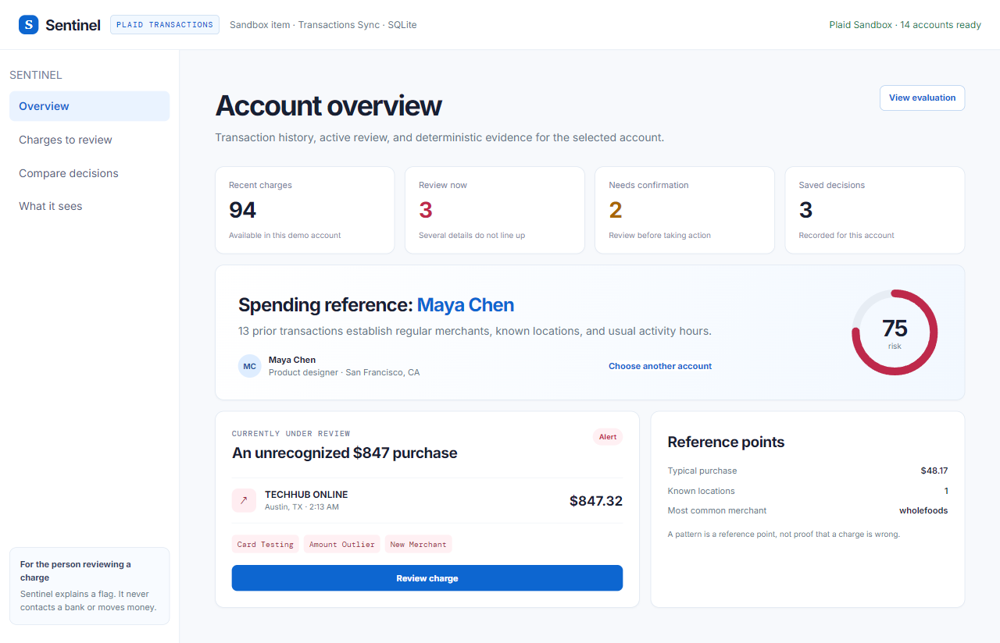
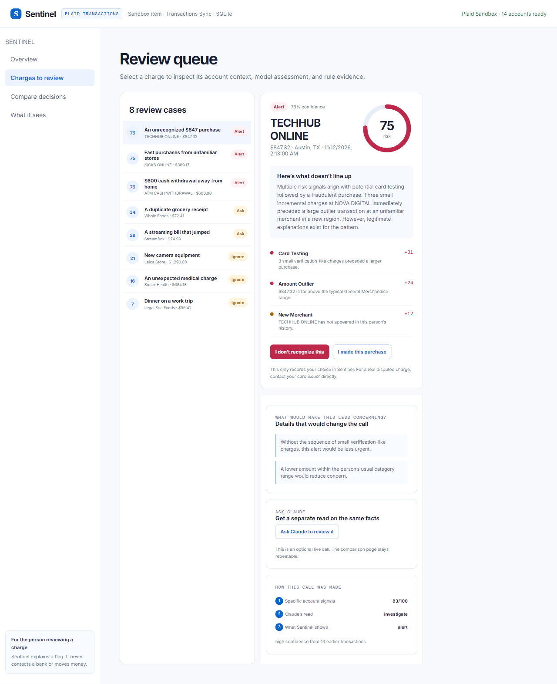
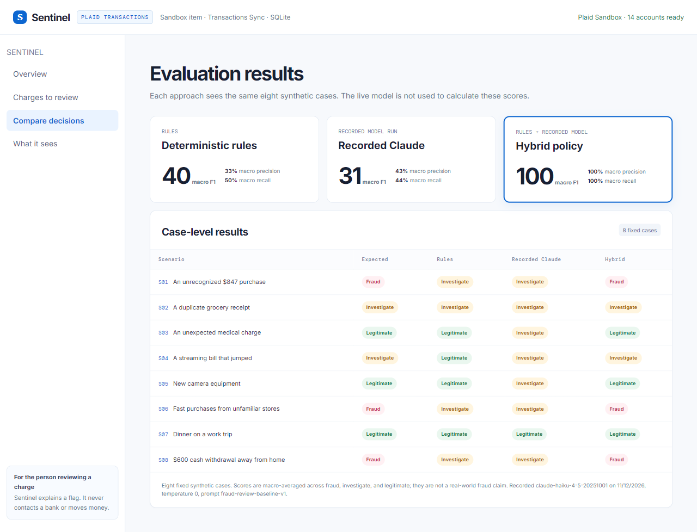

# Sentinel

I started thinking about this while experimenting with Plaid Connector in ChatGPT and Muse. Connecting an account makes transaction history available, but it leaves an important product question open: what should an app show when someone sees a charge they do not recognize?

Sentinel is a prototype for that review step. It is designed around the normalized transaction shape from Plaid’s Transactions Sync flow and compares an unfamiliar charge with prior activity: merchant history, amount, time, location, and nearby transactions. The app keeps the evidence visible so a person can understand why a charge was surfaced before deciding what to do.

The server creates a Plaid Sandbox item, reads account metadata, ingests transaction changes through the cursor-based Transactions Sync API, normalizes those records, and persists them in SQLite. Deterministic checks handle patterns such as duplicate charges and card testing. Claude produces a separate structured assessment, while the comparison screen shows where rules, model output, and the hybrid policy differ.


## Screens

The repository includes the primary flow so it can be reviewed before it is run.

| Overview                                     | Charge review                                   |
| -------------------------------------------- | ----------------------------------------------- |
|  |  |

### Fixed-case comparison



## Where Plaid fits

Plaid does not decide whether a charge is fraudulent. Sentinel uses Plaid for the part Plaid is good at: a normalized view of accounts and transactions.

1. The server creates a Plaid Sandbox item and exchanges its public token server-side.
2. It reads accounts with `/accounts/get` and transaction deltas with `/transactions/sync`.
3. It normalizes merchant, amount, date, category, payment channel, location, and pending state before writing to SQLite.
4. The risk layer uses the same transaction shape to build a person-level spending reference and explain a review decision.

The product screens use synthetic fixtures for the comparison and review demo. That keeps the evaluation repeatable and avoids claiming that Plaid transaction data comes with fraud labels. The live Sandbox connection remains available for inspecting the integration and syncing normalized records.

## 90-second walkthrough

The repository is meant to be readable before it is run.

1. **Overview** establishes a reference profile for Maya Chen from 13 earlier transactions: typical spend, known locations, common merchants, and the charge under review.
2. **Charges to review** examines an $847 purchase at a first-time merchant in Austin at 2:13 AM. The alert includes the rule findings: small card-testing charges, an amount outside Maya's usual range, and no prior merchant history.
3. Selecting **I don't recognize this** stores a resolution in SQLite and prepares an incident summary. The summary groups the charge, related micro-charges, and the issuer guidance shown in the app.
4. **Compare decisions** runs the same cases through deterministic rules, a recorded Claude run, and the hybrid policy. It shows where the approaches agree and where they do not.

## Request flow

| User action                   | Server path                       | What happens                                                                                                                                 |
| ----------------------------- | --------------------------------- | -------------------------------------------------------------------------------------------------------------------------------------------- |
| Open the overview             | `GET /api/dashboard`              | Loads the seeded scenarios, computes their hybrid assessments, and reads recent resolutions and audit events from SQLite.                    |
| Open a charge                 | `GET /api/scenarios/:id`          | Builds a spending reference, evaluates rules, loads the recorded Claude result for that fixed case, and returns the evidence used by the UI. |
| Mark a charge as unrecognized | `POST /api/scenarios/:id/resolve` | Stores the decision, creates an incident summary from the same evidence, and records both events in SQLite.                                  |
| Ask Claude for a second read  | `POST /api/scenarios/:id/claude`  | Sends a minimized context object to the Anthropic Messages API and receives a tool-validated structured response.                            |
| Sync Sandbox data             | `POST /api/plaid/sync`            | Fetches transaction changes with Plaid's cursor-based Transactions Sync endpoint and stores normalized records locally.                      |

## Source map

The main implementation is small enough to inspect from GitHub:

- [`server.mjs`](server.mjs): HTTP routes, Plaid and Anthropic adapters, request validation, and static serving.
- [`src/sentinel-core.js`](src/sentinel-core.js): reference profile, rule findings, hybrid risk policy, counterfactuals, incident builder, and benchmark metrics.
- [`src/claude-baseline.js`](src/claude-baseline.js): the recorded model, timestamp, prompt version, and eight structured Claude results used by the comparison screen.
- [`src/sentinel-db.js`](src/sentinel-db.js): SQLite schema and persistence functions.
- [`src/sentinel-data.js`](src/sentinel-data.js): three personas and eight labeled fraud-review scenarios.
- [`app.js`](app.js): the client-side review flow.
- [`tests/sentinel-core.test.mjs`](tests/sentinel-core.test.mjs): checks for card-testing evidence, travel context, and benchmark separation.

## Design notes

The app assigns charges to **alert**, **ask**, or **ignore**. It considers the account's prior spending, nearby transactions, time of day, location, and category. A new merchant or a high amount alone does not trigger an alert.

Each rule keeps its name, score contribution, and supporting detail. Claude receives a reduced transaction context and returns a structured assessment. The hybrid policy combines those results and generates counterfactuals that show what would reduce the risk score.

The comparison page replays the same labeled scenarios through rules, a recorded Claude result, and the hybrid policy. When a user marks a charge as unrecognized, the incident flow reuses that evidence to prepare a summary.

## Architecture

```text
Plaid Transactions / Demo Scenarios
                ↓
   Transaction normalization + SQLite
                ↓
  Personal spending reference builder
                ↓
  Rules engine ────────┐
                        ├── Hybrid risk policy ──→ alert / ask / ignore
  Claude assessment ───┘
                ↓
   Evidence + counterfactuals + incident summary
```

### Stack

- **Frontend:** JavaScript, HTML, CSS.
- **Server:** Node.js HTTP server with a small request path that is easy to inspect.
- **Database:** SQLite. it stores demo personas, scenarios, audit events, user resolutions, incident summaries, and normalized Plaid transactions.
- **Plaid:** Sandbox item creation, account lookup, and cursor-based `/transactions/sync` ingestion. Plaid credentials and access tokens stay server-side.
- **Claude:** an optional Anthropic Messages API call for a structured assessment of the selected charge. The live response uses tool validation before display.
- **Evaluation:** 8 synthetic, labeled scenarios. The comparison screen uses a committed Claude run so the result is repeatable.

## Implementation choices

Each rule records its name, score contribution, and supporting detail. The UI uses that data to show both the score and the reason for it.

Claude explains the context around a transaction. Deterministic checks keep duplicate charges, card testing, and other high-signal patterns visible and testable.

The comparison page uses eight fixed scenarios so each approach sees the same input. The committed model run records the model, timestamp, temperature, and prompt version. The optional live Claude check is separate because a new model call can vary.

Sentinel does not freeze cards, file disputes, move money, or make claims about real-world fraud accuracy. The incident summary gives the user a record to review before contacting their issuer.

## Run it locally

Sentinel requires Node 22.13+ because the project uses the built-in `node:sqlite` module.

```powershell
nvm use 22
npm start
```

Open [http://127.0.0.1:4173](http://127.0.0.1:4173).

## Optional live services

Create a local `.env` from `.env.example`:

```text
PLAID_CLIENT_ID=...
PLAID_SECRET=...
PLAID_ENV=sandbox
ANTHROPIC_API_KEY=...
CLAUDE_MODEL=claude-haiku-4-5-20251001
```

The demo works without keys. Plaid enables the Sandbox connection and sync path. Anthropic enables **Ask Claude to review it** for a selected charge.

To record a new fixed Claude baseline after changing the prompt, model, or scenarios:

```powershell
npm run record:claude-baseline
```

Review the output before replacing [`src/claude-baseline.js`](src/claude-baseline.js). The committed baseline is intentionally separate from a live model call.

## Test

```powershell
npm test
```

## Evaluation boundary

The Compare Decisions screen uses eight synthetic, labeled scenarios. Precision, recall, and F1 are macro-averaged across fraud, investigate, and legitimate. They describe this small test set only and are not a claim about real-world fraud performance.
