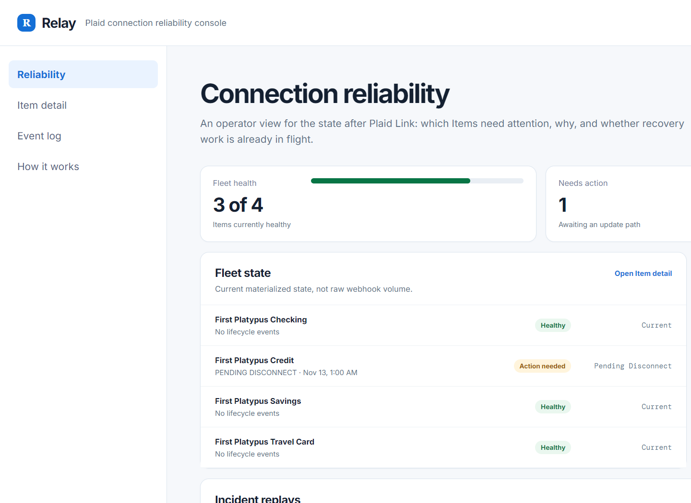

# Relay — Plaid Connection Reliability Console

I started this after using Plaid Connector and thinking past the initial account-linking moment. A connected Item is not permanently healthy: credentials can change, consent can expire, permissions can change, and an app needs to decide whether the user should return to Link.

Relay is a small application-side control plane for that lifecycle. It materializes a fleet view from connection events, makes each recovery decision inspectable, issues one focused Link update session when recovery is needed, and closes work that becomes obsolete. It is deliberately narrow: not another banking dashboard and not a replacement for Plaid Link Recovery.



## What it demonstrates

The central flow is based on Plaid's update-mode guidance:

```text
healthy Item
  → ITEM_LOGIN_REQUIRED / PENDING_DISCONNECT / PENDING_EXPIRATION
  → recovery required
  → one update-mode Link session
  → completed repair or newer LOGIN_REPAIRED
  → healthy Item
```

The console makes the application-side decisions explicit:

- Persist every recovery-relevant event with an idempotency key.
- Reject a duplicate event before it creates another user prompt.
- Prevent more than one active recovery session per Item.
- Ignore an old `LOGIN_REPAIRED` event when a newer issue is still open.
- Supersede an in-progress recovery session if Plaid reports that the login was repaired elsewhere.
- Keep access tokens and Plaid secrets on the server. The browser only receives a short-lived `link_token` for a real Sandbox Link session.

## The proof surface: incident replays

The main console has three deterministic replays, each framed as an operational failure mode rather than a generic demo action:

- **Duplicate delivery:** the same login-required event arrives twice. Relay records the first event and rejects the replay before a second prompt can be created.
- **Out-of-order repair:** an older `LOGIN_REPAIRED` event arrives after a newer issue. Relay keeps the current recovery requirement instead of clearing it with stale data.
- **Repair completed elsewhere:** a newer `LOGIN_REPAIRED` arrives while an update session is open. Relay supersedes the obsolete session and returns the Item to healthy.

Each replay shows the state a naive handler could leave behind alongside the guarded outcome. They are local fixtures, clearly marked in the UI, so the demo does not make claims about production traffic.

## Why Link update mode

Plaid directs integrations to use update mode for `ITEM_LOGIN_REQUIRED`, `PENDING_EXPIRATION`, and `PENDING_DISCONNECT`; it also sends `LOGIN_REPAIRED` when an Item has healed through another app. Relay is an implementation exercise around those lifecycle signals, rather than a claim that Plaid lacks recovery tooling. See Plaid's [update-mode documentation](https://plaid.com/docs/link/update-mode/).

## How the demo works

The app always starts with an offline fixture:

- **First Platypus Checking** is healthy.
- **First Platypus Credit** has a simulated `PENDING_DISCONNECT` event and needs action.

You can run the complete fixture path locally: issue a recovery session, observe the duplicate-session guard, and complete the simulated repair. The event timeline and state count update immediately.

If `PLAID_CLIENT_ID` and `PLAID_SECRET` are configured, Relay also exposes a separate **Launch Sandbox Link** path. It creates a real Sandbox Item server-side and uses `/link/token/create` with the existing Item access token to initialize Link update mode. No access token is sent to the browser. Plaid documents `/sandbox/item/reset_login` specifically for testing this flow. [Plaid testing guidance](https://plaid.com/docs/link/update-mode/#testing-update-mode)

## Architecture

```text
Fixture event or app-side Plaid signal
  → Relay state reducer
  → SQLite Item / event / recovery-session snapshot
  → fleet reliability console and audit trail
  → optional Sandbox Link update session
```

- `src/relay-core.js` is the pure lifecycle reducer and session guard.
- `src/relay-db.js` persists Item, event, and recovery-session state in SQLite.
- `server.mjs` exposes the local recovery API and keeps Plaid credentials server-side.
- `app.js` renders the recovery timeline and fixture/Sandbox paths.
- `docs/relay-spec.md` records the scope and definition of done.
- `docs/relay-test-plan.md` records the lifecycle and UI acceptance cases.

## Run locally

```powershell
npm install
npm start
```

Open `http://127.0.0.1:4173`.

The fixture demo works without any credentials. To enable the Sandbox Link path, add these values to the ignored `.env` file:

```dotenv
PLAID_CLIENT_ID=...
PLAID_SECRET=...
```

## Test

```powershell
npm test
```

The test suite covers login-required and pending-expiration transitions, idempotent event handling, stale self-healing events, single-session enforcement, completion, superseding sessions, token redaction, replay-case behavior, and API persistence.

## Scope and security boundary

Relay is a local Sandbox prototype. Its `POST /api/relay/events` route accepts normalized fixture events for demonstration and is not a production Plaid webhook receiver. Production webhook verification, notification delivery, and production financial data are intentionally out of scope. The UI labels fixture actions separately from the Sandbox-backed Link path.
