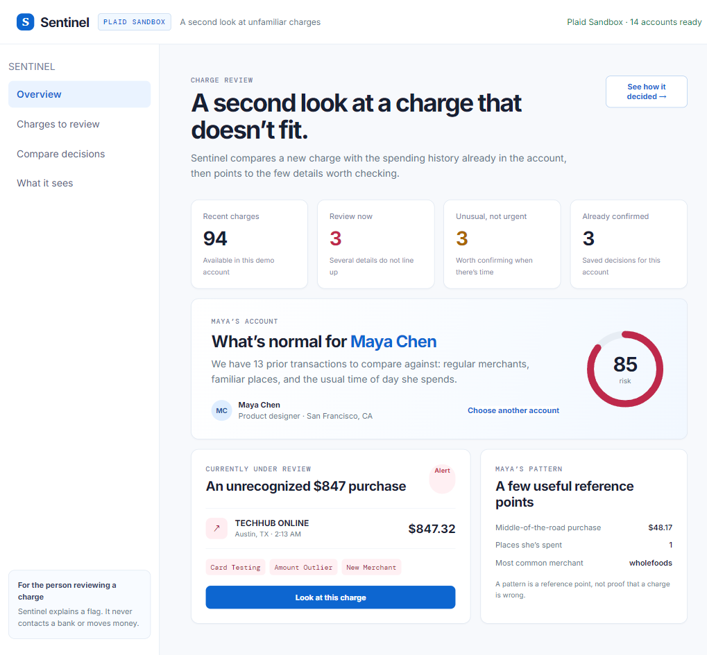

# Sentinel

### A demo app for reviewing suspicious charges with Plaid data, rules, and Claude.

Most fraud alerts ask a user to make a snap call with almost no context: *“Was this you?”* Sentinel compares a new transaction with the account’s spending history and shows the details that do not fit.

This hackathon project uses Claude to explain the context around a charge. Rule checks handle patterns that should stay predictable, such as duplicate charges and card testing.



## Why we made this

Fraud tooling often has two bad failure modes:

- It catches something real but gives the person no useful explanation.
- It flags something harmless—travel, a new merchant, a large planned purchase—and trains the person to ignore future alerts.

Sentinel is designed around that second of hesitation before an alert becomes noise. It separates charges into three outcomes:

- **Alert now** when there is strong, connected evidence.
- **Ask later** when something is unusual but ambiguous.
- **Leave it alone** when the account history gives a reasonable explanation.

Sentinel does not claim to solve fraud. It gives people evidence, shows uncertainty when it exists, and prepares a short summary when they do not recognize a charge.

## What happens in the demo

1. Pick a person and a transaction scenario.
2. Sentinel builds a lightweight spending reference from that person’s history: regular merchants, normal purchase sizes, familiar places, and usual active hours.
3. The rules engine checks for specific signals such as duplicate charges, unusual amount, card testing, rapid spending, and an unfamiliar cash withdrawal.
4. Claude receives only the relevant transaction context and writes a plain-English read of the situation.
5. A hybrid policy turns both inputs into **alert**, **ask**, or **ignore**.
6. If the person selects **“I don’t recognize this,”** Sentinel prepares an incident summary with the charge, related activity, evidence, and issuer-safe next steps.

## What makes it different

| Piece | Why it is there |
| --- | --- |
| Personal spending reference | A $300 purchase can be normal for one person and suspicious for another. |
| Deterministic rules | High-signal patterns such as duplicate charges and card testing remain auditable. |
| Claude context | Helps explain combinations of facts and surface benign explanations without inventing evidence. |
| Hybrid decision policy | Keeps the LLM from becoming the sole decision-maker. |
| Counterfactuals | Shows what would have changed the call—e.g. prior history with a merchant or a lower amount. |
| Incident handoff | Turns “not me” into something useful instead of a dead-end confirmation button. |
| Compare Decisions | Replays the same labeled scenarios through rules only, Claude only, and the combined approach. |

## Under the hood

```text
Plaid Transactions / Demo Scenarios
                ↓
   Transaction normalization + SQLite
                ↓
  Personal spending reference builder
                ↓
  Rules engine ────────┐
                        ├── Hybrid risk policy ──→ alert / ask / ignore
  Claude assessment ───┘
                ↓
   Evidence + counterfactuals + incident summary
```

### Stack

- **Frontend:** vanilla JavaScript, semantic HTML, and responsive CSS.
- **Server:** Node.js HTTP server—small enough to keep the evaluation path readable.
- **Database:** built-in `node:sqlite`; it stores demo personas, scenarios, audit events, user resolutions, incident summaries, and normalized Plaid transactions.
- **Plaid:** Sandbox item creation, account lookup, and cursor-based `/transactions/sync` ingestion. Plaid credentials and access tokens stay server-side.
- **Claude:** optional Anthropic Messages API call for an independent, structured assessment of the selected charge. The live response is validated before display.
- **Evaluation:** a synthetic, labeled scenario suite that makes the product’s behavior repeatable during a demo.

## The technical choices we cared about

**Keep the evidence inspectable.** Each rule records its own name, score contribution, and human-readable detail. The final risk score is never the only explanation.

**Use the model for interpretation, not authority.** Claude can say why several weak signals may matter together and point out plausible benign context. Deterministic evidence still sets the boundaries around the decision.

**Make the demo repeatable.** The baseline comparison uses seeded scenarios, so a judge can replay the same case and see why Rules Only, Claude Only, and Hybrid disagree. The optional live Claude check is deliberately separate from that repeatable benchmark.

**Do not pretend to be a bank.** Sentinel does not freeze cards, file disputes, move money, or claim production fraud-detection accuracy. The incident summary is a well-organized starting point for a person contacting their issuer through an official channel.

## Run it locally

Sentinel requires Node 22.13+ because the project uses the built-in `node:sqlite` module.

```powershell
nvm use 22
npm start
```

Open [http://127.0.0.1:4173](http://127.0.0.1:4173).

## Optional live services

Create a local `.env` from `.env.example`:

```text
PLAID_CLIENT_ID=...
PLAID_SECRET=...
PLAID_ENV=sandbox
ANTHROPIC_API_KEY=...
CLAUDE_MODEL=claude-haiku-4-5-20251001
```

The app is still fully demoable without keys. Plaid turns on the Sandbox connection and sync path. Anthropic turns on **Ask Claude to review it** for a selected charge.

## Test

```powershell
npm test
```

## A note on evaluation

The Compare Decisions screen uses made-up, labeled scenarios. It exists to make the prototype’s choices legible; its precision, recall, and F1 scores are not a claim about real-world fraud performance.
