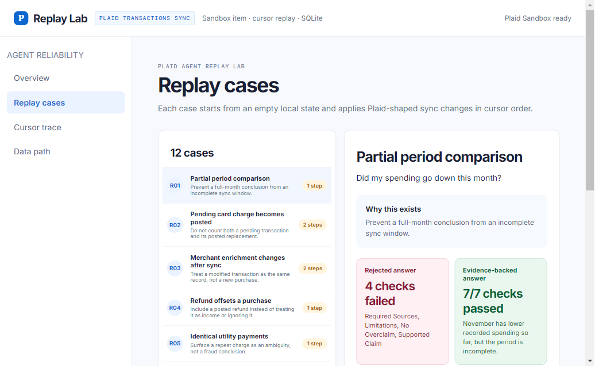

# Plaid Agent Replay Lab

I started this after connecting Plaid to ChatGPT and Muse. The analysis was already useful: ChatGPT could state the accounts and dates it had, distinguish a partial month from a complete one, cite transactions, and avoid treating transfers as ordinary spending.

That shifted the question for me. The problem is not how to make another financial chatbot. It is how to test an agent after the transaction record changes.

Plaid Agent Replay Lab is a compact evaluation harness for that problem. It replays Plaid-shaped Transactions Sync responses, gives an agent either the raw delta stream or a deterministically reconciled current state, then independently scores the resulting answer. A valid answer needs to cite transactions that still exist and disclose limitations such as an incomplete period, a pending-to-posted replacement, a refund, or a removed record.

The project uses synthetic fixtures for expected behavior. The Sandbox integration is separate and shows the real account and cursor-based sync path without claiming that Sandbox transactions have fraud or correctness labels.



## What it tests

The suite covers twelve cases that are easy to mishandle when an agent works from transaction history:

- a partial-period comparison
- a pending card charge that becomes posted
- merchant enrichment applied through a modified transaction
- a refund that offsets a purchase
- two identical utility payments that need confirmation
- a transaction removed by a later sync response
- a settlement amount changed through `modified`
- similar charges across two accounts
- transfer exclusion from a spending total
- incomplete account coverage
- recurring-looking charges and a normal posted-purchase control

Each case starts from an empty local state. The harness applies `added`, `modified`, and `removed` changes in cursor order, then exposes only the final transaction state to the answer validator.

## The answer contract

The validator does not decide whether an answer sounds good. It checks facts that can be tested:

- cited transaction IDs exist in the current replay state
- required source transactions are included
- stale pending or removed records are not cited
- the answer contains the limitations required by that fixture
- a conclusion is present

This keeps the evaluation separate from a model score. An agent can use the MCP tools to inspect a case and submit its own structured answer for validation.

## OpenAI benchmark

The optional benchmark runs the same cases twice: first from raw `added` / `modified` / `removed` batches, then from a deterministic current-state reconciliation. It does not use the reference answer or validation contract as model context. Both outputs are scored afterward by the same independent validator.

Run one case before paying for the full suite:

```powershell
npm run benchmark:openai -- --model <your-model-id> --case R02
```

Run all twelve cases:

```powershell
npm run benchmark:openai -- --model <your-model-id> --all
```

Set a newly issued `OPENAI_API_KEY` in your terminal or `.env`. Raw response reports are written locally to `output/benchmarks/` and are intentionally not committed. A concise result summary belongs in the README only after a real run. See [the benchmark protocol](docs/benchmark-protocol.md).

### First exploratory run

I ran `gpt-6.1-sol` on all 12 cases in both conditions (24 answers total). After correcting wording-only false negatives in the validator and rescoring the saved responses, raw Sync passed 11/12 contracts and reconciled state passed 10/12. That is a single synthetic run, not a general model-performance claim and not evidence that reconciliation improves a model by itself.

The meaningful failure was R06: in both conditions, the model explained that a transaction had been removed but still cited its obsolete ID as evidence. One reconciled R03 answer also omitted the `merchant_enriched` limitation. Those are the kinds of state and provenance errors the harness is designed to expose. [Run notes and limits](docs/first-openai-run.md)

## MCP interface

The local Streamable HTTP endpoint is `http://127.0.0.1:8787/mcp`.

| Tool | Purpose |
| --- | --- |
| `list_replay_cases` | Lists the twelve synthetic replay cases. |
| `get_replay_case` | Returns one case's cursor steps, current transactions, coverage, and answer contract. |
| `validate_financial_answer` | Checks a proposed structured answer against the current replay state. |

All three tools are read-only. They operate on synthetic fixtures and do not access a user's financial data, contact a bank, or submit a dispute.

## Verified connector run

The local MCP server was connected to ChatGPT through an OpenAI Secure MCP Tunnel and exercised against `R02`, the pending-to-posted case. ChatGPT cited `coffee-posted`, excluded the removed pending record, supplied the required `pending_replaced` limitation, and received a five-check pass from the validator. [Verification notes](docs/chatgpt-mcp-verification.md)

## Architecture

```text
Plaid Sandbox
  -> Transactions Sync cursor
  -> normalized SQLite records

Synthetic sync fixture
  -> added / modified / removed replay
  -> current transaction state
  -> answer-contract validator
  -> browser UI or MCP client
```

- `src/replay-suite.js` contains the fixtures, cursor reducer, and answer validator.
- `src/replay-mcp.js` exposes the replay harness through MCP.
- `server.mjs` serves the browser UI and Plaid Sandbox sync route.
- `src/replay-db.js` stores normalized Sandbox transactions in SQLite.
- `tests/replay-suite.test.mjs` tests sync semantics and unsupported citations.
- `tests/replay-mcp.test.mjs` tests the live Streamable HTTP transport.

## Run locally

```powershell
npm install
npm start
```

Open `http://127.0.0.1:4173`.

To run the MCP server separately:

```powershell
npm run mcp
```

The app works in fixture mode without credentials. Add Plaid Sandbox credentials to `.env` to enable the live Sandbox account and sync route:

```dotenv
PLAID_CLIENT_ID=...
PLAID_SECRET=...
PLAID_ENV=sandbox
```

## Test

```powershell
npm test
```

The test suite covers pending replacement, modified merchant enrichment, stale-citation rejection, partial-period disclosure, all reference contracts, and the running MCP endpoint.

## Scope

This is an engineering prototype for replaying synthetic transaction changes. It is not a fraud model, a production financial advisor, or a measure of how ChatGPT performs with a user's connected account. It is a way to make the data assumptions behind an agent answer testable.
